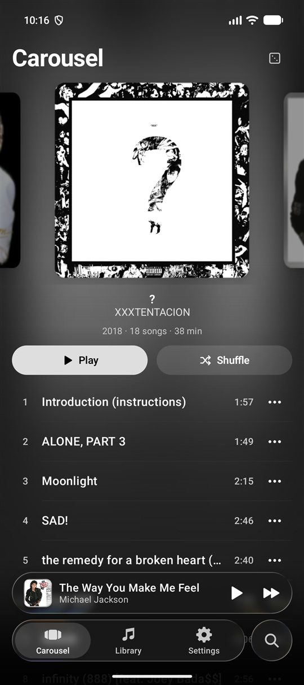
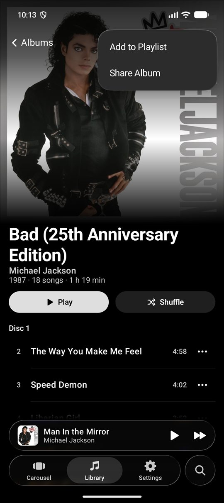
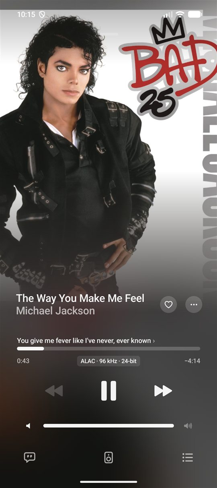
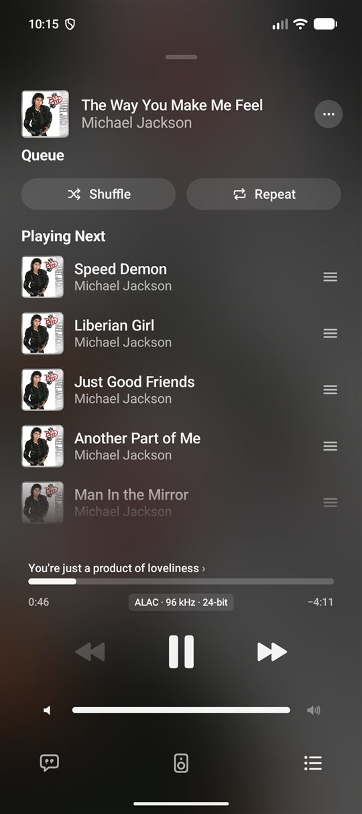
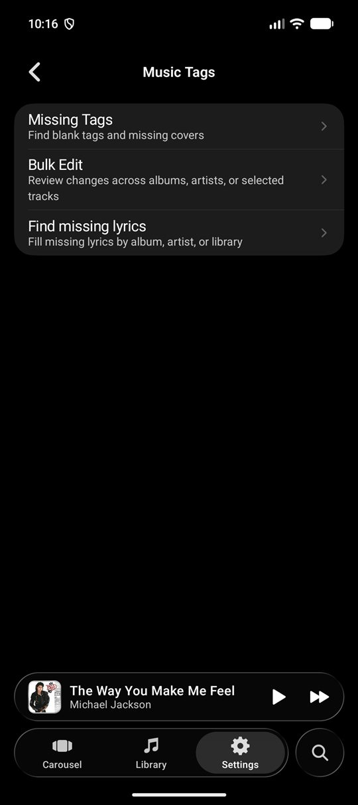
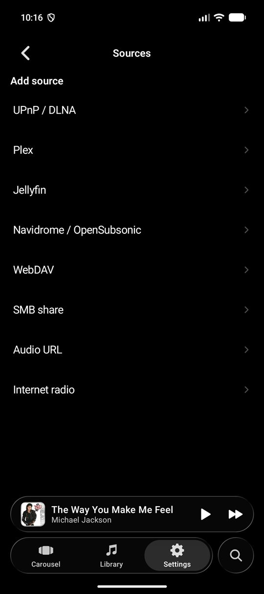
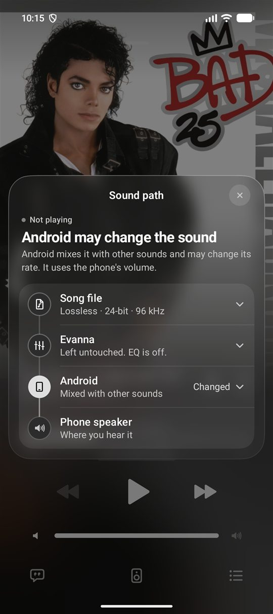
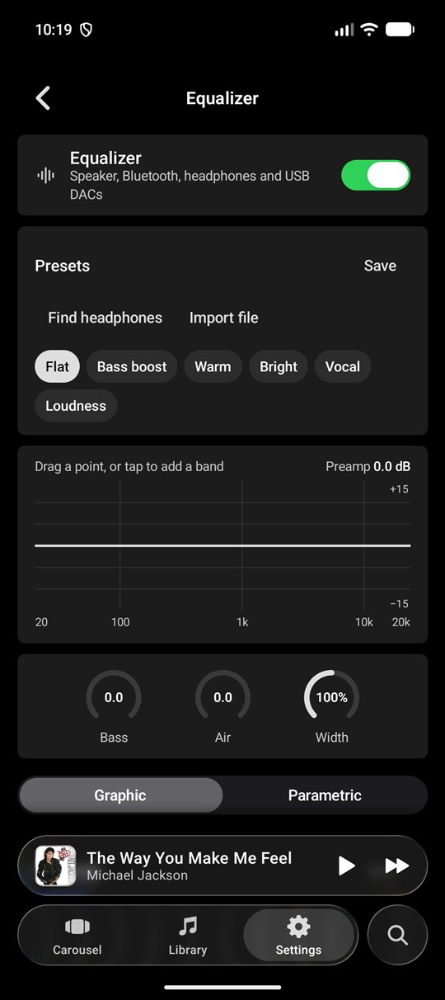

# Evanna


Evanna is a high-resolution music player for Android. Browse music from your phone or SD card, tune it with graphic or parametric EQ, and listen through Android audio or a compatible USB DAC.

**Android 9+** · ARM64, ARMv7, x86 and x86-64

[Download the latest release](https://github.com/dripdropfromablock/evanna-public/releases/latest) · [All releases](https://github.com/dripdropfromablock/evanna-public/releases)

## Showcase

Screenshots from the v1.6 development build on an Android emulator.

| Carousel | Album actions | Now Playing |
| --- | --- | --- |
|  |  |  |

| Queue | Music Tags | Connected sources |
| --- | --- | --- |
|  |  |  |

| Sound path | Equalizer |
| --- | --- |
|  |  |

## New in v1.6

- **Album actions.** Open the three-dot menu on the cover to add the whole album to a playlist or share it. Play and Shuffle sit below the album title.
- **Music tags.** Find missing metadata in **Settings → Music Tags**, review online suggestions, and make bulk edits by album, artist or selected tracks. Evanna saves edits in sidecar files beside the songs.
- **Lyrics.** Find missing lyrics by album, artist or library. The Now Playing preview can follow individual words when the lyrics include word timing.
- **Connected music.** Open **Library → Sources** to browse UPnP/DLNA, Plex, Jellyfin, Navidrome/OpenSubsonic, WebDAV or SMB2/3. The same screen accepts direct audio links, radio stations and M3U/PLS station lists.
- **Network playback.** Play server tracks, add them to the queue and save individual tracks for offline listening. **Audio output → Choose a network speaker** selects a DLNA renderer. HTTPS is available where supported, and local HTTP requires opt-in.

## Features

### Library

- Browse by songs, albums, artists, genres, composers, recently added and folders, with cover, grid and list album layouts, sorting and an A–Z jump bar.
- Search the whole collection or filter inside any view.
- Add multiple folders through Android's folder picker; rescan one or all, cancel a scan, and exclude individual subfolders.
- Favorites, recently played and most played, built from on-device listening history.
- Playlists: create, rename, reorder, save the current queue, and find missing songs; M3U8 import and export.
- Sidecar CUE sheets split single-file albums into individually playable tracks.
- Play any single local file without adding it to the library.
- Decodes FLAC, ALAC, WAV, AIFF, WavPack, Monkey's Audio, TTA, MP3, AAC, Ogg Vorbis, Opus and DSD64 (DSF/DIFF, converted to PCM).

### Playback and queue

- Now Playing sheet with swipeable Lyrics, Song and Queue pages, a floating mini-player, and a choice of framed or full-cover artwork.
- Editable queue with play next, add, reorder and remove, alongside History and Playing Next views; shuffle and repeat off/song/queue.
- Gapless continuation across compatible tracks; the queue and position restore paused after a restart.
- Sleep timer: 15/30/45/60/90 minutes, end of this song, or end of this album.
- Background playback with notification and lock-screen controls and artwork.

### Lyrics and artwork

- Embedded synced lyrics with auto-scroll and tap-a-line-to-seek, word-by-word karaoke fill where word timestamps exist, and a plain-text fallback.
- Read a `.lrc` file beside a song, or find missing lyrics through optional LRCLIB search.
- Embedded covers in lists and the player; the Now Playing backdrop recolours from the album art.

### Share lyrics and albums

- Pick up to four lyric lines and make a 1080 × 1920 story picture. Choose Card, Big words, Cover, Lyrics page, Poster, Quote or Colour. Lyrics page includes the lines around your selection.
- Share album artwork as Card, Floating, Full cover, Cover Flow, Record, Gallery print, Poster, Liner notes or Big type. Liner notes is available from the album page and lists its first six songs and any remaining count.
- Swipe through real picture previews. The look you used last opens first, saved separately for lyrics and albums.
- Save to Photos, send to another app, or open Instagram Stories when Instagram is installed. Card shares use a movable sticker in Instagram; the other looks use the complete picture.

### EQ and sound processing

- Built-in EQ for Android audio and Direct USB, with 15 graphic bands and a live response curve.
- Parametric EQ with up to 16 bands, eight filter types, a preamp and an output limiter.
- Bass, Air and stereo Width controls, named presets, AutoEq headphone search and `ParametricEQ.txt` import.
- Direct USB headphone crossfeed: off, light, medium or strong.
- Direct USB loudness leveling (off/album/track) through the DAC's hardware gain, with an offline library measurement pass.

### USB DAC and outputs

- Direct USB output that bypasses Android's mixer, in Strict or Compatibility mode, with a per-song "play converted once" override.
- Per-DAC profiles: sample-rate ceiling, starting volume, volume limit and volume-key step.
- DAC hardware volume from a slider or the phone's volume keys, with a dB readout and control readback verification.
- Android audio route, plus an Android 14+ bit-perfect mixer option when a compatible USB mixer is present (hardware qualification pending).

### Transparency and privacy

- Audio quality window showing the source format, any processing and what Evanna observed at the output, with minimal and advanced signal-path views.
- On-device crash and ANR reports: review, share a copy, or delete; nothing is uploaded.
- Playback and library browsing work offline. Optional lyrics and AutoEq searches use the internet; release builds check GitHub for app updates and can install them from Settings.

### Comfort and accessibility

- Dark and Light looks, an Increase contrast setting, and adjustable animation speed that honours the system animator scale.
- TalkBack labels and selection states, touch targets of at least 48 dp, and support for larger text.
- Searchable settings.

## Get started

Download the APK for your device from [GitHub Releases](https://github.com/dripdropfromablock/evanna-public/releases). Choose arm64-v8a for most phones or x86_64 for most Android emulators.

1. Install the signed release APK for your device on Android 9 or newer. Existing release-signed Evanna installations can update in place without clearing their data.
2. Open **Library**, add a music folder, and grant access in Android’s folder picker. Repeat for any other folders you want in the library.
3. Select a track and choose an audio output when prompted. For direct USB playback, connect a compatible DAC, grant USB access, and set a low starting volume.

| Output | How it works |
| --- | --- |
| Android audio | Plays through Android’s system audio path. |
| Direct USB | Sends audio through Evanna’s USB audio path to a compatible DAC. Format conversion and sample processing depend on the selected mode and source. |

## Build from source

Install JDK 17, Android SDK 36, NDK `28.2.13676358`, and CMake `3.22.1`. Configure the SDK in Android Studio or set `ANDROID_HOME`.

```powershell
git clone --branch v1.6 https://github.com/dripdropfromablock/evanna-public.git
cd evanna-public
.\gradlew.bat :app:assembleDebug
```

The APK is written to `app/build/outputs/apk/debug/app-debug.apk`. With Android platform-tools installed and a device connected, run `adb install app/build/outputs/apk/debug/app-debug.apk`.

## Run checks

```powershell
.\gradlew.bat :app:testDebugUnitTest :usbaudio:testDebugUnitTest :app:lintDebug :usbaudio:lintDebug
.\gradlew.bat :app:assembleDebugAndroidTest
.\scripts\run-host-audio-tests.ps1
```

Android instrumentation requires an explicitly selected test device. See [fixture provenance](https://github.com/dripdropfromablock/evanna-public/blob/main/docs/test-fixtures.md) for the synthetic decoder fixtures.

## Tech stack

| Layer | Technology | Version / evidence |
|---|---|---|
| Language (app) | Kotlin, JVM target 17 | 2.2.0 — `gradle/libs.versions.toml` |
| UI | Jetpack Compose (Foundation + material-icons-core, Activity Compose) — no Material3 dependency; custom design system | Compose BOM 2025.08.00, Activity 1.10.1 |
| Async | kotlinx-coroutines-android | 1.10.2 |
| Media session | AndroidX Media3 **session** only (decoding is custom FFmpeg JNI, not ExoPlayer) | 1.9.4 |
| Native decode | C++ JNI → prebuilt **FFmpeg 9.0.2** (`libavcodec`, `libavformat`, `libavutil`, `libswresample`) + **libebur128** loudness metering | `app/src/main/cpp/CMakeLists.txt` |
| USB audio | C++ **libusb** UAC1/UAC2 streamer with native EQ, crossfeed, PCM validation, hardware volume; **libsamplerate** for sample-rate conversion | `usbaudio/src/main/cpp/CMakeLists.txt` |
| Build | Gradle Kotlin DSL 8.14.3 (wrapper), AGP 8.10.1, version catalog, CMake 3.22.1, NDK 28.2.13676358 (`c++_shared` app / `c++_static` usbaudio) | `settings.gradle.kts`, `app/build.gradle.kts`, `usbaudio/build.gradle.kts` |
| SDK levels | compileSdk 36; app minSdk 28 / targetSdk 36; usbaudio minSdk 26 | |
| Tests | JUnit 4.13.2; custom instrumentation runner `com.evanna.player.playback.UsbAdapterProbe`; on-device audio fixtures | |
| Tooling | PowerShell (device/test scripts), Python (fixture generators), Bash (FFmpeg build) | `scripts/` |

### Gradle modules

- `:app` — the player application (`com.evanna.player`): Compose UI, library/queue, playback orchestration, FFmpeg decoder JNI, loudness metering.
- `:usbaudio` — Android library (`com.truesample.usbaudio`): direct USB transport via libusb, UAC descriptor parsing, PCM write contracts, native EQ/crossfeed, hardware volume.

### Notes

- Kotlin handles UI, playback orchestration and the built-in EQ. Native C/C++ handles decoding, loudness measurement, sample-rate conversion and USB transport over vendored libraries.
- FFmpeg is consumed as prebuilt libraries per ABI under `third_party/ffmpeg/android/`, rebuilt with `scripts/build-ffmpeg.sh` from the bundled `ffmpeg-9.0.2.tar.xz`; it is not compiled in-tree by Gradle.

## License

The [public Evanna source](https://github.com/dripdropfromablock/evanna-public) licenses original application code and original project materials under GPL-3.0-only unless a file states otherwise. Vendored libraries and tools retain their respective licenses and attribution.

Distribute the matching complete source and build materials alongside APK releases, including the retained FFmpeg archive, native sources, headers, configuration, and build scripts.

[GPL-3.0 license](https://github.com/dripdropfromablock/evanna-public/blob/main/LICENSE) · [Attribution](https://github.com/dripdropfromablock/evanna-public/blob/main/NOTICE) · [Third-party inventory](THIRD_PARTY.md) · [Native library replacement and source delivery](https://github.com/dripdropfromablock/evanna-public/blob/main/docs/native-library-replacement.md)

## Publishing a release that Evanna can discover

Bump Android's version code and version name, build the supported APKs, and sign them using the same release signing key as the previous build. Run `aapt dump badging` on the final APKs to confirm the package is `com.evanna.player` and record each APK's exact version code, version name, and native ABI. Verify that a previous release installation upgrades in place.

Attach the APKs, matching source archive, `evanna-update.json` and `SHA256SUMS.txt` to the same stable release on [Evanna's public GitHub repository](https://github.com/dripdropfromablock/evanna-public/releases). The updater matches the asset names exactly and picks the first matching entry in the phone's supported ABI order. Here is the v1.6 manifest.

```json
{
  "versionName": "1.6",
  "apks": {
    "arm64-v8a": { "assetName": "evanna-1.6-arm64-v8a.apk", "versionCode": 7 },
    "armeabi-v7a": { "assetName": "evanna-1.6-armeabi-v7a.apk", "versionCode": 7 },
    "x86": { "assetName": "evanna-1.6-x86.apk", "versionCode": 7 },
    "x86_64": { "assetName": "evanna-1.6-x86_64.apk", "versionCode": 7 }
  }
}
```

Use the values reported by your actual signed APKs. Once the release is ready, mark it as the latest stable release.
