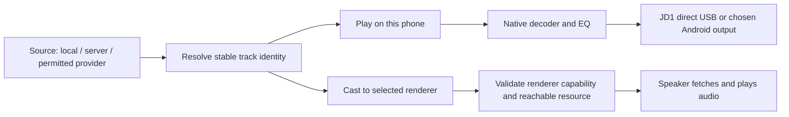

# Connected music for Evanna

Status: implementation approved on 2026-11-17 for the owned-music features.
Commercial online providers are explicitly deferred by the user.
Date: 2026-11-17. Baseline: branch `v1.6`, commit `aea3c0a`.

## Intent and agreed scope

Add UPnP/DLNA, Plex servers, online music providers and other useful network
sources. The user confirmed **both** playback on Evanna/phone/JD1 and casting
to network speakers. Keep the native decoder, EQ and direct USB path wherever
the source actually permits access to decodable audio.

This is several increments, not one release-sized feature. Priority below is a
proposal: first make owned music work end to end, then expand server support,
and implement online providers only after their playback/access gates pass.

## What exists today

- Native decoding feeds `PcmTrack`/`PcmReader`, EQ, and Android/direct USB outputs.
- The instrumentation-only network spike proved HTTP ranges and real HTTPS
  decoding, exact PCM/seeks, EQ, source failure, explicit retry and cancellation.
  A generated loopback stream passed physical JD1 playback/unplug tests. These
  checks are not a production network source or an internet-to-DAC acceptance run.
- `SavedQueueEntry` only accepts local queue IDs and local `content://` paths.
  `PlaybackRuntime` restores from the local library or local document provider.
- `PlaybackService`/`EvannaPlayer` assume `UsbSessionOwner` and local output.
  A remote speaker must not be represented as a fake PCM/USB output.
- There are no production server connectors, server credentials, discovery,
  casting sessions, remote catalog index, or provider playback implementations.

## Approach

Recommended: small built-in source adapters, a shared production network reader,
and a separate remote-renderer session. Reuse the current library/queue/service
where their contracts fit; extend local-only contracts deliberately with migration
tests. Keep server browsing separate from local filesystem scanning.

Alternatives considered:

| Approach | Tradeoff | Decision |
|---|---|---|
| Built-in adapters over shared transport and source identity | Shared correctness work; each server still needs a narrow connector | Recommended |
| Downloadable extension/plugin platform | Versioning, permissions, signing and distribution work before any server plays | Defer until real third-party extension demand |
| Vendor web players/remotes for every source | Can expose some provider playback; does not give Evanna native PCM processing | Only an explicitly labelled optional provider mode |

These are recommendations, not a claim that the user selected every technical detail.

## Two playback paths

Local playback retains all existing DAC gain verification, conversion policy,
pause/unplug protection and signal-path reporting. Network access must not cause
an automatic switch to the speaker or a reset of the saved DAC/EQ settings.

Casting normally sends a resource URI and control commands to the renderer.
The renderer decodes/outputs the audio. Show the actual output device and mark
Evanna EQ/direct USB as inactive for that session. A later processed-audio relay
would be a separate feature with codec, latency and provider-rights tests; it is
not implied by basic casting.

Initially cast reachable, permitted DLNA resources directly. For local phone
files and authenticated owned-server resources, add a session-scoped read-only
LAN relay in a later increment. Do not give a speaker account-wide credentials
or promise that arbitrary protected provider streams can be relayed.

UPnP browsing and transfer are different from renderer control; the standard
defines these roles separately. [OCF architecture](https://openconnectivity.org/wp-content/uploads/2015/11/UPnP-av-MediaServer-v1-Device.pdf),
[renderer service specifications](https://openconnectivity.org/developer/specifications/upnp-resources/upnp/mediaserver4-and-mediarenderer3/).

## Source and output capability matrix

"Planned native" means a target to verify, not a shipped compatibility claim.

| Source | First useful increment | Evanna EQ/JD1 target | Casting target |
|---|---|---|---|
| UPnP/DLNA MediaServer | Discover/add server, browse folders/albums, play original resource | Planned native for supported codecs | Direct resource to compatible DLNA renderer |
| Plex personal music libraries | Sign in, select server/library, browse, original-quality playback | Planned native; verify actual server response | Gate renderer reachability/auth; relay owned media later |
| Jellyfin | Server/user login, music browsing, playback | Planned native; no forced server conversion | Same capability gate |
| Navidrome/OpenSubsonic | Server login, browse/search, original stream | Planned native | Same capability gate |
| Direct HTTP(S) file URLs | Add URL and play finite, seekable file | Planned native | Only permitted renderer-reachable media |
| WebDAV, SMB2/3 | Read-only remote folders | Later native file-source adapters | Local relay later |
| Internet radio/M3U/PLS | Station URLs and live playback | Later; needs a true non-seekable stream reader | Device/protocol dependent |
| Qobuz | Approved access, login, then one full track | Conditional on terms and actual media access | Separate permission/capability gate |
| TIDAL | Approved full-track playback and SDK evaluation | Not established by SDK availability | Separate gate; do not equate with TIDAL Connect |
| Spotify | Optional App Remote or web-player feasibility | Public Android remote route does not feed our engine | Spotify-controlled device playback is separate from DLNA |
| Deezer | Current access/SDK confirmation, then one track | Unverified | Unverified |
| Other commercial providers | Evaluate on explicit demand | No promise before media/DRM/access tests | No promise |

Server API references: [Plex](https://developer.plex.tv/pms/),
[Jellyfin Android/Kotlin SDK](https://kotlin-sdk.jellyfin.org/guide/getting-started.html),
[OpenSubsonic stream](https://opensubsonic.github.io/docs/endpoints/stream/),
[Navidrome compatibility](https://www.navidrome.org/docs/developers/subsonic-api/).
OpenSubsonic documents `format=raw` to request no transcoding; actual codec,
precision and server behavior still require verification.

Provider gates: [Qobuz partnership contact](https://www.qobuz.com/us-en/page/annonceurs-partenariats),
[TIDAL Android player](https://github.com/tidal-music/tidal-sdk-android/blob/main/player/README.md),
[Spotify Android SDK](https://developer.spotify.com/documentation/android),
[Spotify web player](https://developer.spotify.com/documentation/web-playback-sdk),
[Deezer access statement](https://en.deezercommunity.com/features-feedback-44/api-auth-impossible-80857/index1.html).
The TIDAL player owns playback through Media3/ExoPlayer; its existence does not
establish custom-PCM permission or full-track access for this app. Deezer's older
sample is not evidence of currently obtainable production access.

## Shared contracts and storage

- Stable source reference: connection ID + provider/server item ID + media version
  when available. Local references retain current library/document identity.
- Queue-occurrence IDs stay distinct from source/item identity: queuing the same
  song twice is valid. Equal item IDs from two connections must never collide.
- Resolved media is short-lived: URL, scoped request headers, trustworthy size/
  validators if available, format/seek capability, and expiry. Resolve afresh on
  restore or expiry. Never persist signed stream URLs as the durable song ID.
- Queue, local playlists, favorites and history need source-qualified identity;
  do not use the existing local-library hash field for a remote ID. Migrate them
  incrementally, preserving old rows/order/position and document grants.
- Store saved connections and catalog metadata separately from the local scanner.
  Use opaque connection IDs in normal playback state. Keep credentials in a
  Keystore-backed store; diagnostics, notifications, exported playlists and share
  cards must not contain headers, tokens, private URLs or server file paths.
- Removing/signing out of a source makes its saved items unavailable with a clear
  reconnect action; it must not delete unrelated playlists or the local library.
- Start with paginated per-source browsing/search and add global server/local
  search after connector correctness. Respect commercial provider requirements
  for branding, separate experiences and permitted queue/search mixing.

## Production transport and audio behavior

The test proxy is evidence to reuse, not code to expose by simply widening its
URL allowlist. Replace its known header-deadline shortcut with a cancellable
transport enforcing connect/read/overall request limits, including DNS/TLS/header
phases to the chosen library's documented guarantees. Evaluate one maintained
HTTP client against minSdk 28, licensing and cancellation tests; reuse it for
metadata and media rather than separate ad hoc clients.

Finite-file first increment: 64-bit sizes/offsets, checked ranges/validators,
bounded cache and read-ahead, source-change detection, precise EOF, fresh reader
per play, and rapid cancellation/descriptor release. Preserve the tested 64 KiB
range block initially; propose an 8 MiB total transport-cache ceiling, subject to
M30s measurements. Do not cap track length at the prototype's 64 MiB fixture limit.
Unknown-length/live streams and servers without usable ranges need their own
explicit non-seekable or bounded-spooling path, not a fabricated file size.

Expose connecting/buffering/playing/reconnecting/auth-required/unavailable states
with cancel/retry. Never busy-loop on expired credentials or reinterpret an HTML
login/error page as audio. Retries must preserve byte/version identity and a
finite deadline; a mid-body failure cannot concatenate a different representation.
An unrecoverable source error stops output safely; it never silently skips music
or changes the selected output.

Request original quality first. Label server transcoding, resampling, EQ and
unknown source precision truthfully. Do not advertise bit-perfect simply because
the final USB stream has the requested rate. Retain local gapless behavior;
network gapless is enabled only after prefetch/trim/continuity checks pass.

## Connections, LAN and casting safety

- HTTPS and platform certificate/hostname verification by default. LAN HTTP is a
  per-connection choice with a clear warning. Any platform cleartext allowance
  needed for discovered IP addresses is constrained by the shared request policy;
  it must not silently permit external HTTP or credential forwarding.
- Scope credentials to approved origins; validate every redirect. Bound XML/JSON,
  pagination, artwork and playlist parsing. Disable XML external entities/DTD.
  SSDP descriptions and nested resource URLs are untrusted network input.
- Discovery is user-triggered, interface-aware and bounded, with manual address
  entry when multicast fails. Release multicast/network locks when unused. Do not
  enable router port forwarding (UPnP IGD is outside scope).
- Current targetSdk is 36. Plan network-state observation and multicast needs;
  do not blindly add future runtime permissions. Android documents explicit LAN
  permission for target 37+, with denial/revocation handling when adopting it.
  [Android local-network rules](https://developer.android.com/privacy-and-security/local-network-permission).
- Discover remote capabilities before exposing seek, pause or volume controls;
  renderers differ. Bound subscriptions/polling, reconcile external changes and
  never treat a timed-out command as acknowledged playback state.
- Output handoff pauses/stops the old route, confirms the result and only then
  starts the chosen route. If a renderer disappears, show unknown/unreachable
  state; never start local audio automatically. Phone DAC unplug handling applies
  only to the active phone route, not an unrelated casting session.
- Evanna owns its queue/order/shuffle/repeat while casting, initially sending one
  item at a time. Next/previous commands use that queue and resolve resources
  just in time. Auto-advance requires tested evidence that our commanded item
  ended normally; STOPPED alone is insufficient. With ambiguous completion or
  unreliable duration/position reporting, remain stopped and offer manual Next.
- If the next/repeated item cannot cast (including a local file or authenticated
  resource before relay support), stop at that item, retain order and explain the
  incompatibility. Offer an explicit skip or output choice; never skip silently,
  leak credentials, or auto-switch to phone playback.
- If another controller replaces the speaker's URI, cancel Evanna's pending
  progression, show externally controlled playback and preserve Evanna's queue.
  Do not insert the unknown track into saved queues/history. Taking over again
  requires an explicit play/resume action. Reconcile external pause/volume for
  our current item without interpreting a manual stop as end-of-track.
- Process death may leave a directly casting speaker playing independently.
  On restoration, query the saved renderer and reconcile conservatively; don't
  replay, assume ownership, or start local audio. Display unreachable/unknown
  state until the active resource/session can be verified or the user takes over.
- Relay URLs, if implemented, are read-only, short-lived, unguessable and scoped
  to one allowed media item/session. No arbitrary file-serving endpoint, directory
  listing, persistent open port, or provider credential in the renderer URL.

## Product surfaces

Extend Library with a Sources entry and saved-source list; keep existing local
navigation intact. Add connection setup, discovery/manual address, login where
needed, source browsing/search and per-source availability. Add output selection
for this phone/JD1 versus a named network speaker. Now Playing and signal path
show the active source, actual route, conversion and EQ applicability.

Required states: no servers, scanning, multicast blocked, denied LAN access,
auth expired, server offline, empty library, unsupported media, buffering,
read failure, unavailable saved track, renderer busy and renderer lost.
TalkBack labels/focus, text scaling, cancellation and recovery are part of each
increment. Visual layouts should follow the current app; this document does not
preapprove a navigation redesign or placeholder buttons for unavailable services.

## Delivery boundary

Proposed first connected-music release: production network foundation, persistent
remote identity, UPnP browsing/playback, Plex personal music, and direct DLNA
casting of compatible reachable server resources. Ship only increments that pass
their device/server acceptance gates; do not bundle every provider into v1.6.

Next increments: Jellyfin, OpenSubsonic/Navidrome, then private/local-file casting
relay, read-only network folders, live radio and optional offline downloads.
Qobuz and other commercial-provider gates run independently; access failure must
not block owned-server work. Multiroom sync, Chromecast/AirPlay, hosting a full
UPnP server, paid-provider download/decryption, playlist writeback, and runtime
plugins are not part of the first release.

Builder-owned decisions: exact library versions, transport cache tuning, parser
implementation, fixture-server versions and final file splits. Record these at
each increment; request a new product decision only if user-visible scope changes.

Unverified: no actual user Plex/NAS/speaker inventory or supported server-version
matrix yet; provider access and native-audio rights are not granted by this plan.
